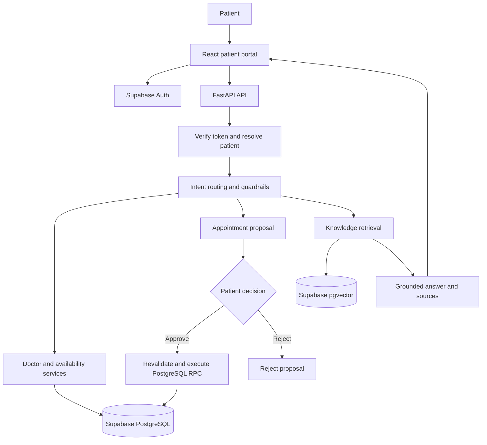

# AI Doctor Appointment Agent

**A patient appointment portal powered by FastAPI, React, LangGraph, Supabase, and retrieval-augmented generation (RAG).**

CarePath helps patients discover doctors, check availability, manage appointments, and ask questions about approved clinic information. Appointment changes require an explicit patient decision before the backend executes them.

> This project provides appointment assistance and clinic information. It does not provide medical diagnosis, treatment, or emergency care.


## Contents

- [Features](#features)
- [Screenshots](#screenshots)
- [Workflow and architecture](#workflow-and-architecture)
- [Technology stack](#technology-stack)
- [Project structure](#project-structure)
- [Getting started](#getting-started)
- [Docker Compose](#docker-compose)
- [Knowledge base and RAG](#knowledge-base-and-rag)
- [API overview](#api-overview)
- [Testing](#testing)
- [Security and current limitations](#security-and-current-limitations)
- [Contributing and license](#contributing-and-license)

## Features

- **Patient portal:** account registration, sign-in, profile onboarding, dashboard, and appointment history.
- **Doctor discovery:** search by name, specialty, clinic, or location; view active doctor profiles and date-specific availability.
- **Appointment management:** prepare, review, approve, or reject booking, cancellation, and rescheduling proposals.
- **AI appointment assistant:** route appointment-related requests through dedicated LangGraph workflows and retain conversation history.
- **Clinic guide:** retrieve approved appointment and clinic information from a Supabase pgvector knowledge base using Voyage AI embeddings.
- **Patient preferences:** store supported specialty, doctor, time-range, and timezone preferences.
- **Safety boundaries:** Supabase Auth token verification, patient ownership checks, workflow guardrails, and database transactions for appointment mutations.

## Screenshots

### Patient dashboard


### AI appointment assistant


## Workflow and architecture

The frontend communicates with FastAPI over `/api/v1`. Supabase Auth establishes the user session; the backend verifies the bearer token and resolves the linked patient profile. Requests then flow through the relevant service or LangGraph workflow.



For knowledge ingestion, an authorized administrator submits approved content. The backend validates and chunks it, generates **Voyage AI** document embeddings, and stores the chunks in Supabase pgvector. A search embeds the query, retrieves active chunks, and passes the resulting context to the configured OpenAI model. An empty retrieval returns an insufficient-information response. Appointment status and availability come from the operational database and services.

For booking and changes, the application creates a patient-owned proposal. The patient explicitly approves or rejects it; approval revalidates the request and invokes a database transaction. The database remains the source of truth for the resulting appointment state.

## Technology stack

| Layer | Technologies |
| --- | --- |
| Frontend | React, TypeScript, Vite, Tailwind CSS, React Router, TanStack Query, React Hook Form, Zod |
| Backend | Python 3.12+, FastAPI, Pydantic, Uvicorn |
| Agent workflows | LangGraph, LangChain, OpenAI |
| Authentication and data | Supabase Auth, PostgreSQL, pgvector |
| Embeddings | Voyage AI (`voyage-4-large` by default, 1024 dimensions) |
| Tests and delivery | Pytest, Ruff, Vitest, Playwright, Docker Compose, GitHub Actions |

## Project structure

```text
.
├── backend/
│   ├── app/
│   │   ├── agentic/          # Orchestrator, workflows, tools, guardrails
│   │   ├── api/              # FastAPI routes, schemas, authentication
│   │   ├── domain/           # Domain models, services, repository contracts
│   │   ├── infrastructure/   # Supabase client and repository adapters
│   │   ├── knowledge/        # Ingestion, embeddings, retrieval
│   │   └── memory/           # Preferences and conversation context helpers
│   ├── scripts/              # Optional synthetic demo-data seeders
│   └── tests/                # Backend unit, integration, and SQL checks
├── frontend/                 # React patient application and browser tests
├── knowledge/                # Example knowledge source documents
├── supabase/migrations/      # PostgreSQL schema and RPC migrations
├── docs/                     # Screenshots used in this README
└── docker-compose.yml
```

## Getting started

### Prerequisites

- Python **3.12 or newer** and [uv](https://docs.astral.sh/uv/).
- Node.js **22** and npm.
- A Supabase project with access to its SQL Editor and Auth settings.
- An OpenAI API key for agent and answer-generation calls, and a Voyage AI API key for embeddings.
- Docker Desktop, if using Compose.

Use an isolated development or staging Supabase project with synthetic data when testing. The commands below use PowerShell from the repository root.

### 1. Set up Supabase

For a **new** project, apply the files in `supabase/migrations/` in numeric order using the Supabase SQL Editor. They define the domain tables, knowledge vectors, appointment transactions, and conversation and preference tables. For an existing database, inspect its schema and migration history before applying changes; do not blindly rerun already-applied migrations.

Migration `005_voyage_embedding_dimensions.sql` switches knowledge vectors to 1024 dimensions and **clears existing embeddings** while retaining document and chunk text. Re-ingest approved knowledge after applying it. Migration `006_conversations_and_memories.sql` requests a PostgREST schema-cache reload on commit; newly added foreign keys on existing tables are `NOT VALID` until legacy rows are reviewed and constraints are validated.

In Supabase Auth URL configuration, allow the frontend callback URL, for example `http://localhost:5173/auth/callback`. If email confirmation is enabled, users must confirm their email before signing in.

### 2. Configure the backend

Create a root `.env` only if it does not already exist:

```powershell
if (-not (Test-Path .env)) { Copy-Item backend/.env.example .env }
```

Edit `.env` and set at least these values:

| Variable | Purpose |
| --- | --- |
| `SUPABASE_URL` | Supabase project URL |
| `SUPABASE_SERVICE_ROLE_KEY` | Server-only key used by backend repositories |
| `SUPABASE_JWT_AUDIENCE` | Expected token audience; normally `authenticated` |
| `OPENAI_API_KEY` | Agent and answer-generation provider key |
| `VOYAGE_API_KEY` | Voyage embedding provider key |
| `VOYAGE_EMBEDDING_MODEL` | Embedding model; defaults to `voyage-4-large` |
| `VOYAGE_EMBEDDING_DIMENSIONS` | Vector size; use `1024` with the supplied migration |

`OPENAI_MODEL`, logging, and optional LangSmith settings are documented in [`backend/.env.example`](backend/.env.example). Settings load from the backend and parent `.env` files; avoid conflicting values. Shell environment variables take precedence. Keep server keys private and never place them in frontend variables.

### 3. Configure the frontend

```powershell
if (-not (Test-Path frontend/.env.local)) { Copy-Item frontend/.env.example frontend/.env.local }
```

Set `VITE_SUPABASE_URL` and `VITE_SUPABASE_PUBLISHABLE_KEY` in `frontend/.env.local` to the same Supabase project URL and its **browser-safe publishable/anon key**. Leave `VITE_API_BASE_URL` empty for development: Vite proxies relative `/api` requests to FastAPI on port 8000.

### 4. Install and run

Start the backend from the repository root:

```powershell
uv sync --directory backend --extra dev
uv run --directory backend uvicorn app.main:app --reload --host 127.0.0.1 --port 8000
```

In a second terminal:

```powershell
Set-Location frontend
npm ci
npm run dev
```

Open the URL printed by Vite, normally [http://localhost:5173](http://localhost:5173). The backend health endpoint is [http://127.0.0.1:8000/api/v1/health](http://127.0.0.1:8000/api/v1/health), and interactive API documentation is at [http://127.0.0.1:8000/docs](http://127.0.0.1:8000/docs).

Register or sign in with a test account, confirm its email if required, and complete patient onboarding. To search or book, the database must contain active doctors, specialties, and future availability. The optional scripts in `backend/scripts/` insert **fictional demo records and policies** into the configured project and make Voyage requests. Review their contents and use an isolated project before running them; the first seed script also creates demo appointments.

## Docker Compose

Compose loads backend runtime settings from `backend/.env`. Create it from `backend/.env.example` if needed and configure the server keys. Put the browser-safe `VITE_SUPABASE_URL` and `VITE_SUPABASE_PUBLISHABLE_KEY` values in the root Compose `.env` before building the frontend image.

```powershell
docker compose up --build
```

The frontend is available at `http://localhost:3000` and FastAPI at `http://localhost:8000`. Stop the services with `Ctrl+C` or `docker compose down`. Frontend Vite values are build-time configuration; rebuild after changing them.

## Knowledge base and RAG

The example Markdown documents in [`knowledge/`](knowledge/) are source material; they are not automatically loaded into the vector database. `POST /api/v1/knowledge/ingest` accepts document content and requires a verified Supabase `app_metadata.role` of `admin` or `superuser`, as well as a linked patient profile. Ordinary patient accounts cannot administer the knowledge base.

After ingestion, the Clinic Guide uses `POST /api/v1/knowledge/search`. Document and query embeddings must use compatible Voyage models and the same dimensions as the pgvector column. Changing the embedding provider, model family, or vector size can require a database migration and re-embedding; do not mix incompatible vectors. Demo policies produced by the seed scripts are fictional and are labeled as such.

## API overview

Explore complete schemas and request bodies at `/docs`. Common endpoints include:

| Area | Endpoints |
| --- | --- |
| Health and profile | `GET /api/v1/health`, `GET/POST /api/v1/patients/me` |
| Discovery | `POST /api/v1/doctors/search`, `GET /api/v1/doctors/{id}`, `POST /api/v1/availability/search` |
| Appointments | `GET /api/v1/appointments`, prepare and approve booking, cancellation, or rescheduling proposals |
| Conversations | `POST /api/v1/chat`, `GET/POST /api/v1/conversations`, conversation detail and preference routes |
| Knowledge | `POST /api/v1/knowledge/search`, administrator-only `POST /api/v1/knowledge/ingest` |

Patient operations use `Authorization: Bearer <Supabase access token>`. The backend verifies the token and determines patient identity; clients do not select a patient by sending an arbitrary ID.

## Testing

Backend checks:

```powershell
uv run --directory backend pytest -q
uv run --directory backend ruff check app tests
uv run --directory backend ruff format --check app tests
```

Frontend checks, from `frontend/`:

```powershell
npm run test
npm run lint
npm run build
npm run test:e2e
```

The Playwright configuration uses an installed Chrome browser and a Windows `npm.cmd` web-server command. Its browser tests intercept API responses; they do not prove live Supabase mutations or model behavior. Use an isolated project and test account for live end-to-end checks.

GitHub Actions currently runs backend Ruff and Pytest checks. Run frontend checks separately when changing the portal.

## Security and current limitations

- Keep service-role, OpenAI, Voyage, database, and LangSmith credentials on the server. Commit only sanitized `.env.example` files.
- Patient appointment changes require a proposal and explicit approval. PostgreSQL RPCs use transaction and locking mechanisms to protect slot changes.
- Knowledge ingestion is restricted to administrator roles. Retrieved text is treated as reference material in the answer prompt; generated output and policy content still require review before real clinical use.
- Chat history can be viewed, but the current orchestrator does not pass prior conversation turns into each new request. Chat does not stream progress or return structured doctor and slot results.
- Patient profile details are read-only in the portal. A separate unlinked patient record with the same email requires clinic support to link it.
- Reminder and notification application behavior is not currently implemented; historical database objects may remain.
- Local CORS allows `localhost:5173` and `127.0.0.1:5173`. A separately hosted frontend requires an appropriate backend CORS configuration.

## Contributing and license

Issues and pull requests are welcome. Keep changes focused, run the relevant checks, and use synthetic data in examples and screenshots. Review configuration, screenshots, logs, and Git history for secrets or patient information before publishing.

No `LICENSE` file is currently included. Choose and add a license before granting open-source usage rights.

**Keywords:** AI doctor appointment agent, healthcare scheduling, FastAPI, React, LangGraph, Supabase, PostgreSQL, pgvector, Voyage AI, RAG, human-in-the-loop.
